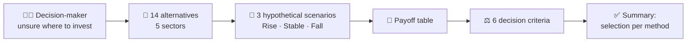
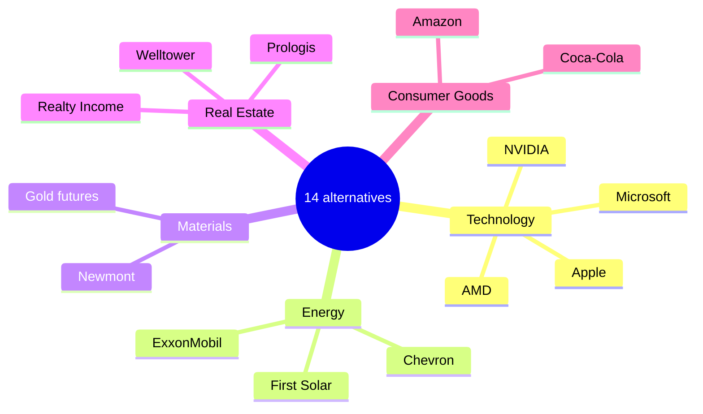

# 📊 Decision Theory Homework
### A Case Study Under Uncertainty

*How do you choose when you know what could happen, but not how likely it is?*

---

## 🎯 Project Purpose and Problem

This project is for **educational purposes only**. It is a hypothetical case study created to practise decision theory, not a real investment plan.

Imagine a student, or anyone who wants to invest a sum of money but does not know where to start or which option to choose. This person has several alternatives across different sectors and must decide **without knowing how likely each future outcome is**.

This is a **decision-making problem under uncertainty**: the possible scenarios are known, but their probabilities are not. The project shows how decision theory gives a structured way to compare the alternatives, and how the preferred choice changes with the decision-maker's attitude.

> [!NOTE]
> The project does not predict the future, give personal financial advice, or encourage anyone to invest.

---

## 🧭 Project at a Glance

---

## 🗂️ Workbook Structure

📎 **Workbook:** [DT_homework.xlsx](DT_homework.xlsx)

The Excel workbook contains three worksheets:

| Sheet | Role |
|---|---|
| 📥 **Data** | Lists each company or asset, its ticker, reference price, price date/source note, and scenario prices. |
| 🧮 **Calculations** | Applies six decision criteria to the scenario outcomes. |
| 📋 **Summary** | Displays the alternative selected by each method and its calculated score. |

---

## 🏢 Investment Alternatives

The workbook covers five areas of the economy. Click a company to open its Yahoo Finance page.

| Sector | Alternative | What it does / represents |
|---|---|---|
| 💻 **Technology** | [Apple (AAPL)](https://finance.yahoo.com/quote/AAPL/) | Consumer electronics, software, and digital services. |
| 💻 **Technology** | [NVIDIA (NVDA)](https://finance.yahoo.com/quote/NVDA/) | Graphics processors and computing technologies used in AI, gaming, and data centers. |
| 💻 **Technology** | [Microsoft (MSFT)](https://finance.yahoo.com/quote/MSFT/) | Software, cloud computing, and productivity services. |
| 💻 **Technology** | [AMD (AMD)](https://finance.yahoo.com/quote/AMD/) | Designs processors and graphics chips. |
| ⛽ **Energy** | [ExxonMobil (XOM)](https://finance.yahoo.com/quote/XOM/) | Oil, natural gas, and related energy products. |
| ⛽ **Energy** | [Chevron (CVX)](https://finance.yahoo.com/quote/CVX/) | Oil and natural gas production and energy products. |
| ⛽ **Energy** | [First Solar (FSLR)](https://finance.yahoo.com/quote/FSLR/) | Manufactures solar-energy technology. |
| ⛏️ **Materials** | [Newmont (NEM)](https://finance.yahoo.com/quote/NEM/) | A mining company focused on gold and other metals. |
| ⛏️ **Materials** | [Gold futures (GC=F)](https://finance.yahoo.com/quote/GC%3DF/) | A reference for gold futures market prices; it is not a company or direct ownership of physical gold. |
| 🏠 **Real Estate** | [Realty Income (O)](https://finance.yahoo.com/quote/O/) | Owns income-generating properties leased to businesses. |
| 🏠 **Real Estate** | [Prologis (PLD)](https://finance.yahoo.com/quote/PLD/) | Owns and operates logistics facilities and warehouses. |
| 🏠 **Real Estate** | [Welltower (WELL)](https://finance.yahoo.com/quote/WELL/) | Invests in healthcare-related real estate and senior housing. |
| 🛒 **Consumer Goods** | [Coca-Cola (KO)](https://finance.yahoo.com/quote/KO/) | Produces and sells beverages. |
| 🛒 **Consumer Goods** | [Amazon (AMZN)](https://finance.yahoo.com/quote/AMZN/) | Operates e-commerce, retail, and cloud-computing businesses. |

These alternatives represent different business activities. They are examples for analysis, not recommendations to buy or sell.

---

## 🔮 Data and Scenario Assumptions

| Type of content | Source | Status |
|---|---|---|
| 🔵 **Market data** | Yahoo Finance, with a price date or source note where available | Observed (dates are not identical for every row) |
| 🟡 **Scenario assumptions** | Chosen for this exercise | Hypothetical and editable |
| 🟢 **Results** | Excel formulas | Calculated automatically |

Three editable hypothetical returns are used in the Data sheet:

| 📈 Rise | ➡️ Stable | 📉 Fall |
|:---:|:---:|:---:|
| **+20%** | **+3%** | **−15%** |

### 🧮 Payoff calculation

The payoff of each alternative in a scenario is its hypothetical scenario price:

$$\text{Scenario Price} = \text{Reference Price} \times (1 + \text{Scenario Return})$$

In Excel, this is the pattern `=D17*(1+$F$7)`: the reference price in column D multiplied by one plus the scenario return stored in row 7.

**Example: gold futures (GC=F)**, reference price $4,216.30

| Scenario | Calculation | Payoff (USD) |
|---|---|---:|
| 📈 Rise | 4,216.30 × (1 + 0.20) | **5,059.56** |
| ➡️ Stable | 4,216.30 × (1 + 0.03) | **4,342.79** |
| 📉 Fall | 4,216.30 × (1 − 0.15) | **3,583.86** |

### 🥇 Result

With these reference prices and assumptions, all six criteria select **gold futures (GC=F)**. This happens because its reference price is much higher than the other alternatives and the payoffs are measured in USD prices, so it comes out ahead under every criterion. It is a result of the chosen inputs, not a recommendation or a prediction that gold will outperform.

These percentages are assumptions for comparing alternatives, not predictions of actual future market prices. Because the workbook's calculations use the scenario prices, the results depend on the selected reference prices and assumptions.

---

## ⚖️ Decision-Making Methods

Each method reflects a different attitude towards risk, so they may not select the same alternative.

| Attitude | Method | Idea |
|---|---|---|
| 🚀 Optimist | **Maximax** | Selects the alternative with the highest possible outcome. |
| 🛡️ Pessimist | **Maximin** | Selects the alternative with the best worst-case outcome. |
| 🟰 Neutral | **Laplace** | Compares the average outcome, treating all scenarios equally. |
| 🎚️ Balanced | **Hurwicz** | Balances the best and worst outcomes using an optimism coefficient. |
| 📐 Risk-averse | **Bernoulli criterion** | Uses a logarithmic utility calculation to compare outcomes. |
| 🔁 Regret-averse | **Opportunity loss (Minimax Regret)** | Selects the alternative with the smallest maximum regret. |

---

## ⚠️ Limitations

> [!WARNING]
> Scenario outcomes are hypothetical. Nothing in this project is a forecast, a recommendation, or financial advice.

- Future scenario returns are hypothetical and are not guaranteed outcomes.
- Historical performance and analyst estimates cannot guarantee future performance.
- Gold futures prices are not the same as the local retail price of a physical gold bar.
- Results depend on the reference prices, scenario assumptions, and decision method used.
- Scenario outcomes are prices in USD rather than percentage returns, so higher-priced assets can stand out under criteria that use absolute values.
- The logarithmic Bernoulli calculation requires positive scenario values.
- This project is for educational purposes only and is not financial advice.

📎 **Workbook:** [DT_homework.xlsx](DT_homework.xlsx)
